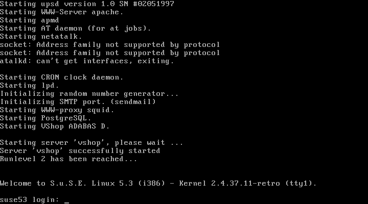

# suse-retro-kernel

**Newer kernels for old SuSE Linux releases — so 1998–2001 SuSE runs on PCs with GBs of RAM, DMA and SATA.**
Kernels más nuevos para SuSE Linux de los 90: para que corran en PCs con GBs de RAM, DMA y SATA.

Each SuSE release gets its own folder: a kernel built for it, packaged as an RPM that installs **next to** the
original kernel (the old one stays as the default boot entry), plus the module tools it needs and the full recipe.

| SuSE release | Kernel | Package | Status |
|---|---|---|---|
| **[SuSE Linux 5.3](suse53/)** (1998, kernel 2.0.35, libc5) | **Linux 2.4.37.11-retro** | `k_retro24-2.4.37.11-2` | [released](../../releases/tag/suse53-k_retro24-2.4.37.11-2) |
| SuSE Linux 6.x | — | — | planned |
| SuSE Linux 7.x | — | — | planned |

Why: the original kernels of that era cannot see SATA/AHCI disks, run IDE in PIO mode on many chipsets and do
not cope with more than ~900 MB of RAM. A late 2.4 kernel still runs the old userland (libc5 included), so the
system can live on modern-ish hardware without touching its programs.

All kernels here are built from the signed kernel.org tarballs with a small patch set and a published config.
Each release carries the exact sources (GPL).

---

Part of the retroblog's SuSE Linux 5.3 series: [installing it](https://www.canaldelasrecetas.com/cms/retro-suse53-instalacion-en/),
[KDE 1.0](https://www.canaldelasrecetas.com/cms/retro-suse53-kde1-en/),
[a VESA driver for XFree86 3.3.2](https://www.canaldelasrecetas.com/cms/retro-suse53-driver-vesa-en/)
([xf86vesa](https://github.com/madgusmx/xf86vesa)) and [cdrecord for SuSE 5.3](https://github.com/madgusmx/cdrecord-suse53).
