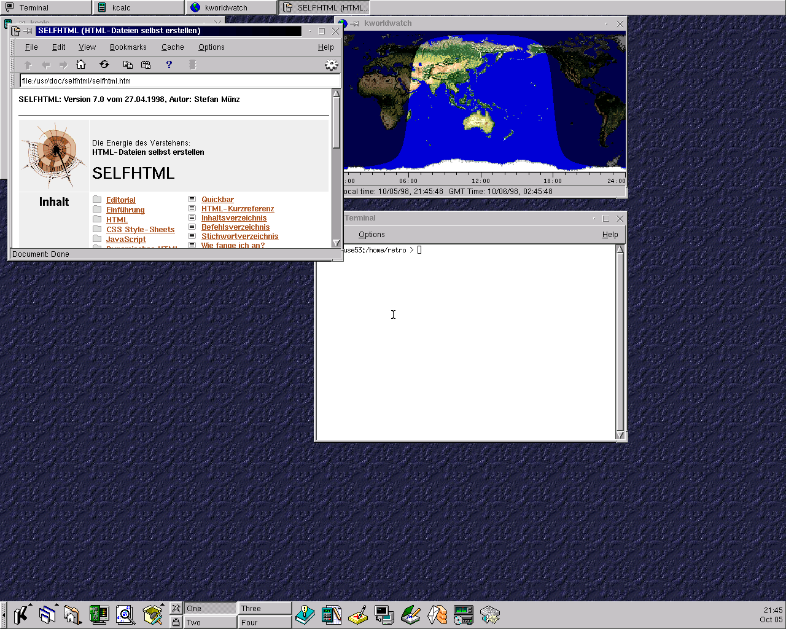
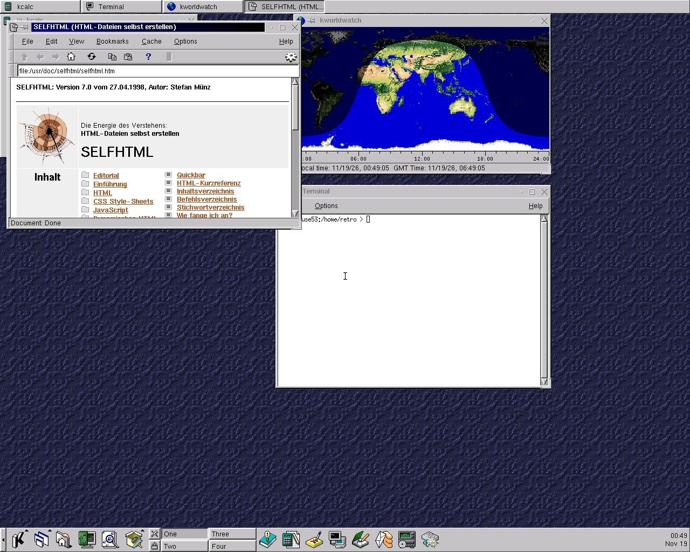

# Linux 2.4.37.11-retro for SuSE Linux 5.3

**`k_retro24`: the last Linux 2.4, built for SuSE Linux 5.3 (1998) — DMA, SATA/AHCI, USB, GBs of RAM, 541 modules.**

[](../../../releases/tag/suse53-k_retro24-2.4.37.11-2)
-green)


📦 **Download:** `k_retro24-2.4.37.11-2.i386.rpm` (and the sources) in the [release](../../../releases/tag/suse53-k_retro24-2.4.37.11-2).



## Install

```sh
rpm -ivh k_retro24-2.4.37.11-2.i386.rpm
# at the LILO prompt: linux24      (the default entry stays SuSE's 2.0.35)
```

The RPM:

1. Installs `/boot/vmlinuz-2.4.37.11-retro`, `System.map`, `config` and `/lib/modules/2.4.37.11-retro` (541 modules).
2. Installs **modutils 2.4.27** (built on SuSE 5.3 itself, libc5) in `/lib/modutils-2.4`. SuSE's `modules-2.1.85`
   moves to `/lib/modutils-2.0`, and `/sbin/insmod`, `modprobe`, `rmmod`, `lsmod`, `depmod`, `ksyms` become a small
   dispatcher that picks one or the other by `uname -r`. **With 2.0.35 nothing changes** (kerneld included).
3. Renames `/etc/conf.modules` to `/etc/modules.conf` (modutils 2.4's name) and leaves a link with the old name.
4. Adds a `linux24` entry to `/etc/lilo.conf` (same root as `/`) with `append="nopentium"` and runs `lilo`.

`rpm -e k_retro24` undoes all of it.

## What is inside

**Built in** (enough to boot anywhere): IDE with automatic DMA (PIIX, VIA, AMD, SiS, ALi, Promise, HPT, CMD,
ServerWorks, SiI…), ide-cd, **ide-scsi**; **SATA through libata**: AHCI (any controller, matched by PCI class —
see the patch), PIIX/ICH, VIA, SiS, NVIDIA, Promise, SiI, ULi, ServerWorks; SCSI disks, CD and generic (`sg`);
ext2/ext3, iso9660 (Joliet, zisofs), UDF, FAT/VFAT, NFS, tmpfs, devpts; NE2000, RTL8139, e100, e1000, PCnet32,
tulip, VIA Rhine, 3c59x, PPP; USB (UHCI/OHCI/EHCI) keyboard, mouse and storage; a.out + ELF; SysV IPC (ADABAS
needs it); APM, RTC, parallel port. No framebuffer: X keeps using its own drivers (or
[xf86vesa](https://github.com/madgusmx/xf86vesa)), as with 2.0.

**Modules** (kmod loads them): OSS sound (SB, ES1370/1371, i810…), AppleTalk, IPX, more network cards, SCSI
adapters, filesystems, I2C/bttv and more — 541 in total, all compiled, none with unresolved symbols (`depmod -ae`).

**Burning CDs** ([cdrecord for SuSE 5.3](https://github.com/madgusmx/cdrecord-suse53)): IDE/ATAPI burners with
`linux24 hdc=ide-scsi` at the LILO prompt; SATA burners work directly.

## Tested

In virtual machines (Proxmox/QEMU):

| Test | Result |
|---|---|
| SuSE 5.3 (Pentium, 64 MB, IDE) with the RPM, booting `linux24` | runlevel 2, ADABAS, network, DMA on (213 MB/s in the VM vs. PIO on 2.0) |
| KDE 1.0 + xf86vesa at 1280x1024 on 2.4 | works (the driver's vm86 calls are fine on 2.4) |
| Modules | kmod loads appletalk, ipx (+ psnap, p8022); `modprobe` without warnings |
| Same machine booting SuSE's 2.0.35 after installing | unchanged: kerneld, `ne` module, old modutils |
| `rpm -e` / upgrade from `-1` | everything restored / `nopentium` added |
| SuSE 5.3 restored onto a **SATA (AHCI) disk, 2 GB RAM** | boots straight into 2.4.37.11-retro, ADABAS, KDE |



Not tested yet: real hardware. Reports welcome.

## Known issues

- **`nopentium`**: with more than 896 MB of RAM (highmem) this 486 build panics early —
  `Bad pmd in pte_alloc: 400000e7` / `Kernel panic: Failed to allocate buffer hash table` — when it maps memory
  with 4 MB pages. `nopentium` turns those off; with 896 MB or less it is not needed. The RPM's LILO entry has it.
- SuSE's `modules.conf` ships `alias net-pf-5 off` (AppleTalk off). Change it to `appletalk` if you use netatalk.
- `kmod: failed to exec /sbin/modprobe ... parport_lowlevel` at boot happens before the root is mounted; harmless.
- On 2.4 the local network route is added automatically, so `/etc/route.conf` may print `File exists`.

## Building it

SuSE 5.3's gcc 2.7.2.1 cannot build Linux 2.4. The kernel was built with **gcc 3.3.5 from Debian sarge** in an
unprivileged chroot (`setarch i686` so that configure does not see x86_64):

```sh
python3 kernel/preparar_config.py linux-2.4.37.11 kernel/retroblog.config   # defconfig + our fragment
python3 kernel/modularizar.py linux-2.4.37.11                               # extras as modules
make -C linux-2.4.37.11 ARCH=i386 oldconfig                                 # -> kernel/config-2.4.37.11-retro-mod
bash kernel/armar_kernel.sh linux-2.4.37.11.tar kernel/config-2.4.37.11-retro-mod out/
```

- [`kernel/ahci-clase.diff`](kernel/ahci-clase.diff): the AHCI driver of 2.4 only knows a list of chips up to ICH9;
  the patch adds a match on PCI class 01.06.01, as 2.6 does, so any AHCI controller is picked up.
- [`kernel/retroblog.config`](kernel/retroblog.config): the readable fragment (486, HIGHMEM 4G, what is built in).
- The RPM (`rpm/k_retro24.spec`) is then built **on SuSE 5.3** from the kernel output plus modutils 2.4.27, which
  needs `env -` around its configure: SuSE 5.3's bash 1.14 crashes on `unset MAIL`.

Sources in the release: the signed `linux-2.4.37.11.tar.xz` and `modutils-2.4.27.tar.gz` from kernel.org (with
their `.sign`), `kernel-retro24-fuentes.tar.gz` (patch, configs, scripts) and the source RPM.
